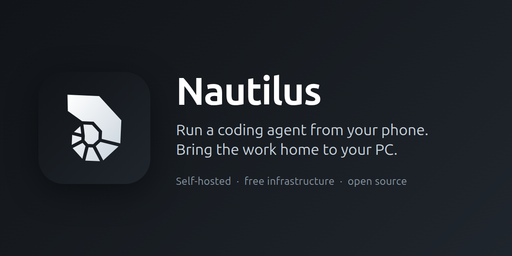

# Nautilus

[](https://github.com/itamarhanan/nautilus/actions/workflows/ci.yml)
[](./LICENSE)



Nautilus pairs an installable phone PWA with a coding agent in the cloud. You prompt the agent and watch it work from a phone, on a train, with your laptop closed. Back at your desk, a desktop app shows you a real diff and merges the agent's work into your project. It never touches your `.git` directory.

It runs on Vercel's free Hobby plan and Neon's free Postgres tier. There is no credit card, no domain, no Docker and no paid VM.

## Quick start

1. **Deploy the web app** to Vercel, with Neon Postgres attached. See [Deploying](#deploying) for the two secrets to set.
2. **Install the desktop app** from the [latest release](https://github.com/itamarhanan/nautilus/releases/latest). See [the table below](#install-the-desktop-app) for which file to pick.
3. **Connect the desktop.** Open **Settings › Runner**, paste your deployment's URL and admin token, and press **Save and connect**.
4. **Link your phone.** Press **Link phone** in the desktop app, scan the QR code and add the app to the home screen.

The first request wakes the runner, which takes about fifteen seconds. To try everything on one machine first, see [local development](#local-development).

## The idea

A phone is a good place to _ask_ for work and a bad place to _review_ it. So Nautilus splits the job.

| On the phone                                   | On the PC                                           |
| ---------------------------------------------- | --------------------------------------------------- |
| Pick a project and send a prompt               | Keep the real project and its Git history           |
| Stream the agent's turn as it happens          | See a real content diff before anything changes     |
| Approve or deny the commands it asks to run    | Pull, push, or choose a side per conflicting file   |
| See each turn's changed files, and undo a turn | Compare both versions of a conflict, open an editor |
| Lock the screen and get told when it's done    | Undo the last pull                                  |

The PC does **not** need to be online while the agent works. It only has to be online when you sync.

On the phone you can also pick the model and, for models that have them, the reasoning effort. A meter shows how full the context is, and every reply shows its tokens and cost.

Live previews of a project's dev server are turned off in this release. A sandbox that sleeps can't keep a dev server up, and a preview that half works is worse than none.

## How it holds up

Most of the engineering here is about what happens when things go wrong. The details are in [docs/architecture.md](./docs/architecture.md) and [docs/sync-protocol.md](./docs/sync-protocol.md). Here are the parts worth reading first.

```
   phone (PWA)              Vercel                                   your PC
  ┌────────────┐  cookie  ┌──────────────────────────┐  admin   ┌──────────────┐
  │  chat      │─────────►│  web app (functions)     │◄─────────┤  Tauri app   │
  │  history   │          │  Postgres: phones, codes │  token   │              │
  └────────────┘          └────────────┬─────────────┘          │              │
                                       │ runner key             │              │
                                       ▼                        │              │
                          ┌──────────────────────────┐          │  ┌───────────┤
                          │  Vercel Sandbox: runner  │   relay  │  │ sync-agent│
                          │  OpenCode, projects,     │◄─────────┼──┤ 127.0.0.1 │
                          │  shadow git repos        │ (polls)  │  │ :4100     │
                          └──────────────────────────┘          └──┴───────────┘
```

There are three places code runs. The **web app** on Vercel serves the PWA, keeps phones and pairing codes in Postgres and forwards every other API call to the runner. The **runner** lives in one persistent Vercel Sandbox and runs the agent, the projects and the runner's side of sync. The web app wakes it on demand. The **PC** runs the desktop app and its sync agent.

### The runner restarts all the time

A sandbox session on the Hobby plan lasts at most 45 minutes. The filesystem survives, the processes do not, and a file written just before the stop can come back older or cut short. Nautilus treats every start as a full recycle, not a hiccup.

- The web app starts the runner when a request needs it. A lease in Postgres makes sure two requests never start it twice. The phone shows the runner starting and checks again every few seconds.
- On start the runner rolls back any sync that did not commit, then checks each project's shadow repository and compares the folder with its last checkpoint. A project that fails is marked `unhealthy` and is not served or synced. Serving a restored tree as if it were current would be worse than refusing.
- A turn that was running is never reported as finished. It becomes `interrupted`, and the phone offers a retry.

### Your Git is not the agent's memory

The agent's work needs history, checkpoints, three-way merges and undo. Your own branches, hooks and remotes must stay out of it. So each side keeps a **shadow repository**, a bare Git directory whose worktree is the real project folder. Your `.git` is never read or written.

- **Sync is incremental.** A `git bundle` carries only the commits after the last shared base. It is checked by SHA-256 and for ancestry before it is imported.
- **Merges are preflighted.** Both sides are merged in a throwaway index, with `git read-tree -m` and `git merge-file` for files both sides edited, before anything is written. A conflict applies nothing, not even partly. You pick a side per file and apply again.
- **Applies are transactional.** A transaction record and a recovery bundle are written before the first file changes. An interrupted apply is rolled back on the next start and never reported as synced.
- **What Git cannot round-trip is refused.** Symlinks, submodules, `.gitmodules`, Git LFS pointers and oversized files fail with a clear error. Dependencies, caches and secret files stay out: `.env*`, `.envrc`, `.dev.vars`, keys and certificates (`*.pem`, `*.key`, `*.p12`, `*.pfx`, `id_rsa*` and the like). A file that was synced before it counted as secret is never deleted from either side. A nested checkout stays out too, and the desktop tells you once.
- **Every agent turn is a checkpoint.** The phone lists the files each turn changed and can undo one turn while keeping the ones after it, the way `git revert` does. An undo is a checkpoint too, so it can be undone.

### The PC never accepts a connection

The sandbox cannot reach your PC, and your PC does not listen on the internet. So the PC reaches out.

- **The sync agent opens the link.** During a sync you started, the PC's sync agent long-polls the runner over HTTPS, runs each request it gets against itself, and posts back the answer. The link needs a 15-minute token from the web app and closes when the sync ends. Bundles go straight to the sandbox, so they skip the web app's size and time limits.
- **The capability file is the desktop's security boundary.** The app can start exactly one program, the sync agent that ships inside it. The agent is a Node single executable, so the PC needs no Node install. The app reads only `~/.nautilus/**` and `package.json` files, and makes HTTP requests only to `127.0.0.1` and to HTTPS.
- **The PC mints the grants.** For each pull or push the agent signs a grant for one project and one direction, capped at 10 minutes whatever the UI asks for. The runner passes it along and cannot make one. A push grant cannot call `apply`, so a push never writes to the PC.
- **The launch key dies with the app.** The agent reads a 32-byte key from stdin and exits when the desktop closes that pipe. Restart the app and every earlier grant stops working.
- **One token on the PC.** The desktop keeps the admin token in `~/.nautilus/config.json`, mode 0600. Change `NAUTILUS_ADMIN_TOKEN` on Vercel to revoke it.
- **Little Rust.** `main.rs` registers plugins and owns what a web page cannot: the tray icon, hiding to the tray on close and keeping one instance. All sync policy lives in the capability manifest and TypeScript.

### The sandbox is public, the runner is not

A sandbox's port has a public HTTPS address, so the runner checks every request.

- The runner answers only requests that carry the runner key, which only the web app knows, and it trusts the web app's word on who is calling only alongside that key. The key is derived from `NAUTILUS_AUTH_SECRET`, so there is nothing extra to set.
- A phone links once with a single-use pairing code. Postgres stores only its hash, redeeming one is rate limited per IP, and the desktop can revoke a phone at once. The session cookie is a signed token, so a forged one never reaches Postgres or the runner.
- Every cookie write to `/api/*` needs an `Origin` that matches the site and an `X-Nautilus-Request: 1` header, which a cross-site form cannot set.
- Admin routes return 404 to a phone, so it cannot confirm they exist. Every secret comparison is timing-safe.

### Keys never reach the agent

OpenCode runs inside bubblewrap when the sandbox allows it, where the runner's secrets folder is empty. The runner key and the model provider's credentials are removed from its environment. If a stored preview value still shows up in its output, the runner replaces it with `[redacted:KEY]` before it is stored or reaches the phone.

### The phone loses its connection, often

Prompts are `POST`, which rules out `EventSource`. The PWA uses a streaming `fetch` with its own SSE parser, and the server sends a heartbeat every 25 seconds. Every event has a sequence number. A reconnecting phone loads a snapshot and resumes from the last sequence it saw. A Vercel function stops after five minutes, so the web app ends each stream a little before that and the phone picks up where it left off.

## Repository layout

```
apps/
  web/          @nautilus/web         the phone PWA and the gateway: sign-in, Postgres, waking
                                       the sandbox and forwarding to the runner (Next.js)
  runner/       @nautilus/runner      the runner: API, registry, OpenCode bridge, sync
                                       coordinator, sync relay, restart recovery
  desktop/      @nautilus/desktop     the Tauri app: phone linking, diff review, tray
  sync-agent/   @nautilus/sync-agent  the PC's loopback agent that answers sync requests
packages/
  shadow-git/   @nautilus/shadow-git  the shadow repository and durable-file helpers
  types/        @nautilus/types       the shared wire types
  copy/         @nautilus/copy        the words a person reads, keyed by the state they describe
  brand/        @nautilus/brand       logo, colors and icon generation
docs/
  architecture.md   the gateway, the sandbox, the relay, trust boundaries, restarts
  sync-protocol.md  shadow repositories, pull, push, checkpoints, undo, recovery
```

## Install the desktop app

Download the installer for your system from the [latest release](https://github.com/itamarhanan/nautilus/releases/latest). Nothing else is needed: the sync agent ships inside the app, so the PC needs no Node, Rust or pnpm.

| System                    | File                                        | Install                                                   |
| ------------------------- | ------------------------------------------- | --------------------------------------------------------- |
| Ubuntu, Debian and others | `nautilus-desktop_<version>_amd64.deb`      | `sudo apt install ./nautilus-desktop_<version>_amd64.deb` |
| Any Linux                 | `nautilus-desktop_<version>_amd64.AppImage` | `chmod +x` the file, then run it                          |
| macOS (Apple Silicon)     | `Nautilus_<version>_aarch64.dmg`            | Open it and drag Nautilus to Applications                 |
| Windows                   | `Nautilus_<version>_x64-setup.exe`          | Run it                                                    |

The builds are not signed. macOS says the app "cannot be opened"; right-click it in Applications, choose **Open**, then **Open** again. Windows SmartScreen may warn about an unknown publisher; choose **More info**, then **Run anyway**.

Then connect the app to your deployment in **Settings › Runner**.

## Deploying

1. **Create a Vercel project** from this repository with **Root Directory** set to `apps/web`. The build bundles the runner into the web app, so the functions can write it into the sandbox.
2. **Attach Neon Postgres** from the Vercel marketplace. It sets `DATABASE_URL`. The web app creates its tables on first use.
3. **Set the secrets.** Generate each with `openssl rand -hex 32`:

   | Variable                      | Purpose                                                                                         |
   | ----------------------------- | ----------------------------------------------------------------------------------------------- |
   | `NAUTILUS_AUTH_SECRET`        | 32+ characters. Signs phone sessions and derives the runner key. Changing it signs phones out.  |
   | `NAUTILUS_ADMIN_TOKEN`        | 32+ characters. The desktop's token. Paste it into the desktop's settings.                      |
   | `NAUTILUS_OPENCODE_AUTH_JSON` | Optional. The contents of OpenCode's `auth.json`, to use a provider beyond the free Zen models. |

4. **Deploy**, then check it:

   ```bash
   curl https://<your-app>.vercel.app/health   # {"status":"ok","runner":"asleep"} until the first request
   ```

The functions reach Vercel Sandbox with the project's OIDC token, which Vercel provides on its own. A deploy with a new runner build restarts the runner on its next wake.

To get `auth.json`, run `opencode auth login` on any machine and copy `~/.local/share/opencode/auth.json`. The phone's model picker lists whatever the provider's catalog reports.

## Local development

You need Node **24.15.0 or newer**, pnpm **10.28.1** (through corepack) and a Postgres URL, such as a Neon branch. For building the desktop app you also need Rust and the [Tauri 2 prerequisites](https://tauri.app) for your OS.

```bash
corepack enable
pnpm install
pnpm dev:local
```

This starts the runner on `127.0.0.1:4000`, the web app on `:4002` and the desktop app. The first run writes a `.env.local` with fresh secrets. Add `DATABASE_URL` to it. With `NAUTILUS_RUNNER_URL` set, the web app skips the sandbox and forwards to that runner, and the relay uses the same address.

To run the pieces yourself:

```bash
pnpm dev                                    # turbo: runner, PWA and desktop frontend
pnpm dev:web                                # the PWA only
pnpm --filter @nautilus/runner dev          # the runner only, with reload
pnpm --filter @nautilus/desktop tauri:dev   # the real Tauri shell
```

The runner keeps sync within 10 MB per file, 100 MB per project and 10,000 files.

## Development

```bash
pnpm test        # tests
pnpm lint        # eslint, one flat config for the whole workspace
pnpm typecheck
pnpm format      # oxfmt
pnpm build
pnpm --filter @nautilus/desktop tauri:build   # the packaged app, with the sync agent inside
```

The tests lean on the parts where correctness is not obvious: shadow repository policy and merge semantics, transaction rollback, undoing a pull on both sides, grants and their refusals, CSRF and origin checks, gateway sign-in and forwarding, the sync relay, restart recovery, the desktop's review flow, and stream reconnection. Sync tests run against real Git repositories, not mocks, which is why the suite allows each test 20 seconds.

```bash
pnpm vitest run apps/runner/test          # one package
pnpm test:watch                           # watch mode
```

`lint` and `test` run once from the repository root rather than per package; `typecheck` and `build` stay per package, because each has its own tsconfig and dependency order.

See [CONTRIBUTING.md](./CONTRIBUTING.md) before sending a change.

### Releasing the desktop app

The Release workflow builds the installers on Linux, macOS and Windows runners and attaches them to a draft release. Each platform builds on its own runner, because the sync agent inside the app is a copy of that machine's Node.

```bash
# 1. Set "version" in apps/desktop/package.json, e.g. 1.0.1, and commit it.
# 2. Tag that commit with the same version and push the tag:
git tag v1.0.1 && git push origin v1.0.1
# 3. When the workflow finishes, write the summary line at the top of the
#    draft's notes, check the files and publish it.
```

The draft's notes come from `scripts/release-notes.sh`, which lists the new features and fixes since the previous tag, grouped by the part of Nautilus they touch, and adds the install table. Run it locally to preview a release's notes: `scripts/release-notes.sh v1.0.1`.

The workflow refuses a tag that does not match the version. Linux ships a `.deb` and an AppImage but no `.rpm`: the app carries a whole Node runtime, and Tauri's RPM packer compresses it slowly enough to stall a build.

## Status

Nautilus is maintained on demand. Reported bugs get fixed, so [open an issue](https://github.com/itamarhanan/nautilus/issues) if something breaks. New features are not planned as of October 2026.

## License

[GPL-3.0](./LICENSE).
